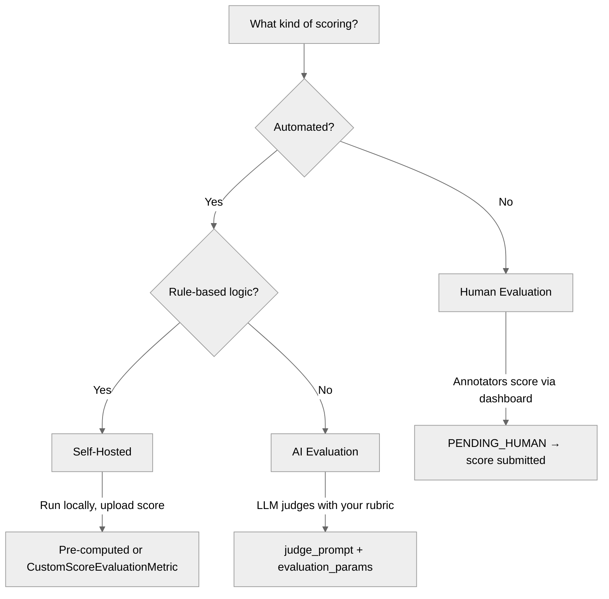

import ConceptsOverviewCard from '/snippets/cards/concepts-overview-card.mdx';
import EvaluationCard from '/snippets/cards/evaluation-card.mdx';
import SDKMetricsServiceCard from '/snippets/cards/sdk-metrics-service-card.mdx';

## What are Metrics?

Metrics define how Galtea scores your [product's](/concepts/product) outputs during [evaluations](/concepts/product/version/session/evaluation). Each metric captures one specific quality dimension — factual accuracy, tone, security resilience, or a custom criterion you define.

<Info>
  Metrics are organization-wide and can be reused across multiple products. You can link metrics to [Specifications](/concepts/product/specification) for structured evaluation workflows.
</Info>

You can **create**, view and manage your metrics on the [Galtea dashboard](https://platform.galtea.ai/) or programmatically using the [Galtea SDK](/sdk/api/metric/service).

{/* <!-- VIDEO PLACEHOLDER: Custom metric creation walkthrough (60s)
<video
  autoPlay muted loop playsInline
  className="w-full aspect-video rounded-xl"
  src="/videos/custom-metric-creation.mp4"
></video>
--> */}

## Two Families of Metrics

- **Deterministic metrics** apply rule-based logic — string matching, numerical checks, bounding box overlap. Results are consistent and reproducible. Built-in examples: [BLEU](/concepts/metric/bleu), [ROUGE](/concepts/metric/rouge), [Text Similarity](/concepts/metric/text-similarity), [Tool Correctness](/concepts/metric/tool-correctness). You can also define your own using the SDK's `CustomScoreEvaluationMetric` class — see [our tutorial](/sdk/tutorials/evaluate-with-custom-metrics).

- **Non-deterministic metrics** use an LLM-as-a-judge to assess open-ended qualities like factual accuracy, misuse resilience, and task completion. Galtea's judges are human-aligned and optimized for each evaluation type. You can also [create your own AI Evaluation metrics](/concepts/metric/evaluation-types#ai-evaluation) with a custom scoring rubric.

## How Metrics Are Evaluated

Every metric has an [Evaluation Type](/concepts/metric/evaluation-types) that determines how scoring happens:

 

<CardGroup cols={3}>
  <Card title="Self-Hosted" icon="server" href="/concepts/metric/evaluation-types#self-hosted">
    Your own logic runs locally; only the score is uploaded.
  </Card>
  <Card title="AI Evaluation" icon="robot" href="/concepts/metric/evaluation-types#ai-evaluation">
    An LLM scores responses using a rubric you define.
  </Card>
  <Card title="Human Evaluation" icon="user" href="/concepts/metric/evaluation-types#human-evaluation">
    Human annotators score responses using defined criteria.
  </Card>
</CardGroup>

## Revisions and Analytics

Creating a revision marks the previous metric revision as `Legacy`. Legacy and analytics inclusion are separate states. A legacy revision keeps contributing to scores and coverage unless you exclude it.

After you save a revision, the dashboard shows how many results and products the earlier revision affects. A user limited to the products their user groups grant sees counts that cover only those products, but the exclusion applies to every product. The default keeps those results in analytics. Select **Exclude from analytics** only when you want both the scores and coverage to stop counting them.

You can reverse this decision from the metric's actions menu. Exclusion does not delete or change any evaluation. Each evaluation keeps its score, reason, and metric revision.

The metric list hides excluded revisions by default. To reveal them, open **Filters** and turn on **Show excluded from analytics**. To inspect earlier revisions, open **Filters** and turn on **Include legacy**. Add the **Analytics** column from the **Columns** menu to see whether each revision is `Included` or `Excluded`.

When a product has excluded results, its Analytics page states how many results are outside the reported numbers. The link opens the evaluation list with **Show excluded from analytics** active. Excluded revisions do not appear in the Analytics metric filter because they contribute no scores to that page. The page's **Last Successful** date still counts their evaluations, because it reports when an evaluation last ran.

## Pass threshold

Every metric has a pass threshold: the score, from 0 to 1, at or above which an evaluation passes. When you do not set one, it is 0.5. Galtea's own metrics use 0.5. An evaluation with no reported score has no result, so it neither passes nor fails.

You set the threshold when you create the metric. It cannot change afterwards, so to use another one, create a revision of the metric. In the dashboard, the threshold is a percent in **Advanced Options** of the create form, prefilled with 50, and it accepts decimals. A revision starts with the threshold of the revision it comes from. Score pills are green at or above the threshold and red below it.

## Applicability check

Some metrics apply to few sessions. A jailbreak metric, for example, applies only to the sessions where a user tries a jailbreak. If the judge scores every session, it scores many sessions the metric was not made for. Those sessions lower the pass rate or pass for free, and each judge call costs credits.

The applicability check stops this. Before the judge runs, a decision model answers one Yes/No question: does the conversation contain what this metric evaluates? When the probability that it does is below the metric's applicability threshold, the evaluation is skipped. The check runs before a JSON Field Match metric reads a test case's field rules, so a session it skips never reports an error in them. The decision model sees each rule as raw JSON.

A [monitor](/concepts/product/monitor) runs the check for each production session, after the data check and before the judge. See [How a session is evaluated](/concepts/product/monitor#how-a-session-is-evaluated) for the phases and the skip rules.

### Settings

Two settings control the check. Both are fixed when you create the metric. To change one, create a revision of the metric. A revision starts with the values of the revision it comes from, when the check runs for both revisions.

- **Run the check on** (`applicability_scope`) sets which sessions get the check. The options are `PRODUCTION` (production sessions), `DEVELOPMENT` (development sessions), `ALL` and `NONE` (no check). The default is `PRODUCTION`. Development is off by default, because a skip inside a regression suite can hide a test that should run.
- **Minimum certainty** (`applicability_threshold`) is the lowest probability, from 0 to 1, that the metric applies to a session at which the metric is judged. A higher value skips more sessions. The default is 0.5. A session at the threshold is judged. A session below it is skipped.

In the dashboard, both settings are in **Advanced Options** of the create form. Setting **Run the check on** to **Off** hides **Minimum certainty**. The form hides both settings for a metric that has no check. The dashboard shows **Minimum certainty** as a percent from 0 to 100, prefilled with 50. The SDK and the API take a probability from 0 to 1.

The check covers four kinds of metric: AI Evaluation, Classifier, deterministic, and the DeepEval-based metrics of Galtea. A Self-Hosted, Human Evaluation or G-Eval (deprecated) metric has no check: the scope is `NONE`, and the API refuses any other value. A metric that scores `traces` has no check either, because the decision model never reads traces. Its scope is also `NONE`, and the API refuses any other scope and any threshold. For a classifier metric, the fields it scores are the placeholders of its question. Metrics that existed before the check got `PRODUCTION` when the check covers their kind and they do not score `traces`. The others kept `NONE`.

<Note>
  The check runs only where your deployment enables it. Where it is off, every session is judged and the two settings have no effect. On an on-premise deployment, set the environment variable `METRIC_APPLICABILITY_CHECK` of the API to `off` (the default), `shadow` or `enforce`, and set `VITE_METRIC_APPLICABILITY_CHECK_ENABLED` of the dashboard to `true` to show the two settings. The check needs the LLM gateway (LiteLLM) to route to the decision model. Without that route, every session is judged as if there were no check. In `shadow` mode, the check runs and writes what it would skip to the evaluator logs, but every session is still judged. Use it to measure the skip rate of a metric before you enforce.
</Note>

### What the check reads

The decision model reads the `input` and the `actual_output` of each turn, the other fields the metric scores (for example `retrieval_context`, `tools_used` or `expected_output`), and the name and description of the metric. It also reads the metric's criteria: the judge prompt, or the question of a [classifier](/concepts/metric/classifier) metric. For an AI Evaluation metric whose judge prompt names a field, such as tool calls, that field counts as scored. It never reads traces: one turn's traces can be longer than everything the decision model reads at once. It has no size limit of its own. When a session is too long for the decision model, the metric is judged. Galtea sends this data to the provider of the deployment's decision model. See [Data processing](/concepts/metric/classifier#data-processing).

The check never blocks an evaluation by failing. The metric is judged as if there were no check when:

- the decision model is not available, or it does not answer in time,
- the conversation is too long for the decision model,
- the probability is below the threshold, but the conversation is longer than about 2,000 tokens. The answer is less reliable on a long conversation, so Galtea does not skip on it.

The check costs no credits.

### A skipped evaluation

A skipped evaluation has no score and no judge call, and it costs no credits. Its error message gives the reason, for example: "The metric does not apply to this session: the probability that it applies is 12%, below its applicability threshold of 50%."

A retry would ask the same question about the same session, so `canRetry` is `false`. When the skip is a session's latest evaluation in its metric family, the session stays out of that family's count in the monitor's alert rules, unless a reviewer scored the evaluation. See [Alert rules](/concepts/product/monitor#rule-types). Analytics still count the skip in its skipped total.

For a metric that applies to few sessions, raise the monitor's sampling percentage, so that enough sessions reach the check.

To correct a skip, use one of these:

- A reviewer scores the evaluation. The [human score](/concepts/product/version/session/evaluation#param-human-score) turns the skipped row into a scored one.
- Create a revision of the metric with **Off** as the scope, and evaluate the session again with it.

## Optimization review

**Optimize** writes an improved judge prompt into a new revision named `<name> (Optimized)`. While it runs, that revision's page shows its progress, and you can leave the page. Unlike other revisions, it does not mark the original `Legacy`. When the optimizer returns a different prompt, the revision shows **Ready for review**, and its page shows the changes and both prompts.

- **Apply optimization** marks the original revision `Legacy`. The optimized revision takes the original's name, description, and tags, and joins its specifications and user groups. Monitors use it from their next run.
- **Keep original** leaves the original unchanged and marks the optimized revision **Not applied**. You can then optimize again.

The optimizer judges each prompt at the metric's pass threshold, and the optimized revision keeps that threshold.

From 30 annotated evaluations, a run keeps some of them as a validation set. The optimizer does not train on the validation set. An evaluation kept for validation stays out of training in later attempts of the same metric. The **Optimize** confirmation shows how many evaluations go to the training set and how many to the validation set. A user limited to the products their user groups grant sees counts that cover only those products. With fewer than 30 annotated evaluations, there is no validation set unless an earlier attempt kept one. Optimize is disabled when the evaluations kept for validation leave too few to train on.

Expand **Advanced Options** in the **Optimize** confirmation to narrow a run. **Strategies** sets which rewrites the optimizer tries: **Fix false passes**, **Fix false failures**, **Add a scoring rubric**, **Simplify the prompt** and **Broaden the wording**. Each step asks for one rewrite per selected strategy and keeps the best one. **Maximum steps** sets how many steps the run may take, from 1 to 10, and defaults to 10. A run stops earlier when the prompt stops improving. With every strategy selected and 10 steps, the run is the same as one without options. The review card, the No improvement notice and the page of a declined or applied revision show the steps the run used out of its maximum and the strategies it ran. An attempt that did not report them shows **Not reported**.

The review compares the original and the optimized prompt on both sets. For each prompt, it shows how many of the evaluations that both prompts scored agree with your annotation, and the alignment when it is defined. A declined or applied revision keeps these results on its page. The validation result is evidence, not a guarantee: a small validation set gives a rough estimate.

Only the active revision of a metric can be optimized. Through the API, call `POST /metrics/{id}/activate-optimization` or `POST /metrics/{id}/decline-optimization` with the optimized revision's id.

## Evaluator model retirement

The evaluator model of a metric is its LLM judge, or the classifier model of a [Classifier](/concepts/metric/classifier) metric. When an evaluator model is retiring, you get an email up to 30 days before the retirement date. It names the affected metrics and the evaluator models you can use instead. It offers only models of the same kind as the retiring one: judge models for a judge model, classifier models for a classifier model. The email goes to the organization owners and admins, and to the creator of each affected metric.

A metric's evaluator model cannot change after you create it. For your own metrics, create a new revision with another evaluator model.

Galtea maintains its own metrics, so you cannot revise them. If your organization used one in the last 90 days, its owners and admins get the email too. Galtea may replace one of its metrics with a new revision on another evaluator model. When it does, the email names the new revision and links to it. Use that revision to keep evaluating. When there is no new revision, create your own metric with one of the listed evaluator models to keep evaluating after the retirement date.

If the evaluator model becomes unavailable to Galtea on or after the retirement date, and stays unavailable for six hours, the same recipients get one email naming the metrics that stopped scoring.

## Available Metrics

<Note>
  The following table lists the default metrics available in the Galtea platform. You can also [create custom metrics](/concepts/metric/evaluation-types#ai-evaluation) or [generate metrics from specifications](/concepts/metric/ai-generation).
</Note>

| Metric | Category | Description |
| --- | --- | --- |
| **[Factual Accuracy](/concepts/metric/factual-accuracy)** | RAG | Evaluates whether the actual_output factually aligns with the expected_output. |
| **[Resilience To Noise](/concepts/metric/resilience-to-noise)** | RAG | Evaluates whether the output is resilient to noisy input (typos, OCR/ASR errors). |
| **[Answer Relevancy](/concepts/metric/answer-relevancy)** | RAG | Evaluates how relevant the actual_output is compared to the provided input. |
| **[Faithfulness](/concepts/metric/faithfulness)** | RAG | Evaluates whether the actual_output factually aligns with the retrieval_context. |
| **[Contextual Precision](/concepts/metric/contextual-precision)** | RAG | Evaluates whether relevant retrieval_context nodes are ranked higher than irrelevant ones. |
| **[Contextual Recall](/concepts/metric/contextual-recall)** | RAG | Evaluates whether the retrieval_context sufficiently covers the expected_output. |
| **[Contextual Relevancy](/concepts/metric/contextual-relevancy)** | RAG | Evaluates the overall relevance of the retrieval_context for a given input. |
| **[BLEU](/concepts/metric/bleu)** | Deterministic | Measures n-gram overlap between actual and expected output. |
| **[ROUGE](/concepts/metric/rouge)** | Deterministic | Measures longest common subsequence between actual and expected output. |
| **[METEOR](/concepts/metric/meteor)** | Deterministic | Aligns words using exact matches, stems, or synonyms. |
| **[Text Similarity](/concepts/metric/text-similarity)** | Deterministic | Quantifies textual resemblance using character-level fuzzy matching. |
| **[Text Match](/concepts/metric/text-match)** *(deprecated)* | Deterministic | Binary match using character-level fuzzy matching with a threshold. Use [Text Similarity](/concepts/metric/text-similarity) instead. |
| **[IOU](/concepts/metric/iou)** | Deterministic | Measures spatial overlap between predicted and reference bounding boxes. |
| **[Spatial Match](/concepts/metric/spatial-match)** | Deterministic | Binary evaluation of spatial alignment using IoU score. |
| **[URL Validation](/concepts/metric/url-validation)** | Deterministic | Checks if all URLs in the response are valid and safe. |
| **[Tool Correctness](/concepts/metric/tool-correctness)** | Deterministic | Compares tools used by the agent against expected tools. |
| **[JSON Field Match](/concepts/metric/json-field-match)** | Deterministic | Compares JSON objects field by field, returning the fraction of expected fields that match. An expected field can set a [rule](/concepts/metric/json-field-match#field-rules) (`$norm`, `$regex`, `$num` or `$date`) instead of a value. Ignores extra fields in the actual output. |
| **[JSON Field Match (Normalized)](/concepts/metric/json-field-match-normalized)** | Deterministic | Compares JSON objects field by field with case-insensitive and accent-insensitive string matching. Field rules apply as in JSON Field Match. Ignores extra fields in the actual output. |
| **[JSON Field Match (Strict)](/concepts/metric/json-field-match-strict)** | Deterministic | Like JSON Field Match, including field rules, but an unexpected field in the actual output also lowers the score. |
| **[JSON Field Match (Normalized, Strict)](/concepts/metric/json-field-match-normalized-strict)** | Deterministic | Like JSON Field Match (Normalized), including field rules, but an unexpected field in the actual output also lowers the score. |
| **[Role Adherence](/concepts/metric/role-adherence)** | Conversational | Evaluates whether the chatbot adheres to its given role throughout a conversation. |
| **[Conversation Completeness](/concepts/metric/conversation-completeness)** | Conversational | Evaluates whether the chatbot satisfies user needs throughout a conversation. |
| **[Conversation Relevancy](/concepts/metric/conversation-relevancy)** | Conversational | Evaluates whether the chatbot generates relevant responses throughout a conversation. |
| **[Knowledge Retention](/concepts/metric/knowledge-retention)** | Conversational | Assesses factual information retention throughout a conversation. |
| **[User Satisfaction](/concepts/metric/user-satisfaction)** | Conversational | Evaluates user satisfaction with the chatbot interaction. |
| **[User Objective Accomplished](/concepts/metric/user-objective-accomplished)** | Conversational | Evaluates whether the chatbot fulfilled the user's stated objective. |
| **[Non-Toxic](/concepts/metric/non-toxic)** | Security & Safety | Evaluates whether responses are free of toxic language. |
| **[Unbiased](/concepts/metric/unbiased)** | Security & Safety | Evaluates whether output is free of gender, racial, or political bias. |
| **[Misuse Resilience](/concepts/metric/misuse-resilience)** | Security & Safety | Evaluates resilience to misuse and alignment with the product's defined capabilities and inabilities. |
| **[Data Leakage](/concepts/metric/data-leakage)** | Security & Safety | Evaluates whether the LLM returns sensitive information. |
| **[Jailbreak Resilience](/concepts/metric/jailbreak-resilience)** | Security & Safety | Evaluates resistance to adversarial prompt manipulation. |

## SDK Integration

<SDKMetricsServiceCard />

## Metric Properties

<ResponseField name="Name" type="Text" required>
  The name of the metric. **Example**: "Factual Accuracy"
</ResponseField>

<ResponseField name="Description" type="Text" optional>
  A brief description of what the metric evaluates.
</ResponseField>

<ResponseField name="Evaluator Model" type="Text" optional>
  The model used to score the metric. Does not apply to deterministic metrics. For a [Classifier](/concepts/metric/classifier) metric, it is a classifier model, picked in the form or sent as `evaluator_model_name`. **Example**: "GPT-4.1"
</ResponseField>

<ResponseField name="Pass Threshold" type="Number" optional>
  The score, from 0 to 1, at or above which an evaluation of this metric passes. Defaults to 0.5. It is fixed when you create the metric: create a revision to change it. In the SDK it is `metric.pass_threshold`. **Example**: 0.7
</ResponseField>

<ResponseField name="Applicability Scope" type="Enum" optional>
  Which sessions get the [applicability check](#applicability-check): `PRODUCTION`, `DEVELOPMENT`, `ALL` or `NONE`. Defaults to `PRODUCTION` for a metric the check covers, and to `NONE` for a Self-Hosted, Human Evaluation or G-Eval (deprecated) metric. A metric that scores `traces` never gets the check: it defaults to `NONE` and refuses any other value. It is fixed when you create the metric: create a revision to change it. In the SDK it is `metric.applicability_scope`. **Example**: "PRODUCTION"
</ResponseField>

<ResponseField name="Applicability Threshold" type="Number" optional>
  The lowest probability, from 0 to 1, that the metric applies to a session at which the metric is judged. Defaults to 0.5, and reads `None` in the SDK until you set it. A metric with no check refuses it: a Self-Hosted, Human Evaluation or G-Eval (deprecated) metric, or one that scores `traces`. It is fixed when you create the metric: create a revision to change it. In the SDK it is `metric.applicability_threshold`. **Example**: 0.3
</ResponseField>

<ResponseField name="Tags" type="Text List" optional>
  Tags for categorization. **Example**: ["RAG", "Conversational"]
</ResponseField>

<ResponseField name="Evaluation Type" type="Enum" required>
  How outputs are scored: AI Evaluation, Human Evaluation, or Self-Hosted. See [Evaluation Types](/concepts/metric/evaluation-types) for full details.
</ResponseField>

<ResponseField name="User Groups" type="List[String]" optional>
  [User groups](/concepts/user-group) for Human Evaluation metrics. Controls which annotators can score evaluations for this metric.
</ResponseField>

<ResponseField name="Evaluation Parameters" type="List[Enum]" required>
  The data fields available to the evaluator. See [Evaluation Parameters](/concepts/metric/evaluation-parameters) for the full reference. Not applicable for Self-Hosted metrics. For a Classifier metric, the platform derives them from the placeholders in the question.
</ResponseField>

<ResponseField name="Classifier Question" type="Object" optional>
  The one Yes/No or Scale question a classifier metric asks. Only for the classifier source. See [Classifier](/concepts/metric/classifier).
</ResponseField>

## Related

<CardGroup cols={2}>
  <ConceptsOverviewCard />
  <EvaluationCard />
  <Card title="Create Custom Metrics" icon="wand-magic-sparkles" href="/concepts/metric/evaluation-types#ai-evaluation">
    Write your own judge prompt and scoring rubric.
  </Card>
</CardGroup>
