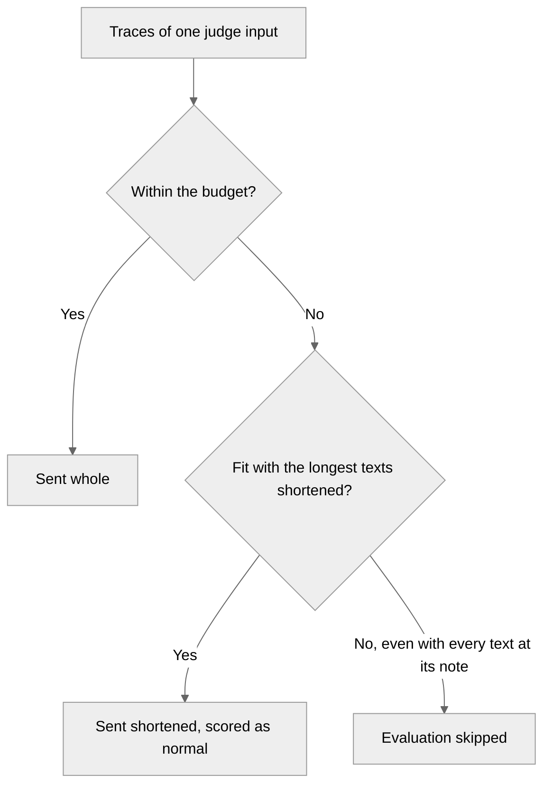

This page applies to every metric that scores the [`traces` parameter](/concepts/metric/evaluation-parameters).

## In short

- **All the traces of one judge call share one budget.** The budget is 120,000 characters by default. It covers every turn the judge reads in that call, all together, not each trace.
- **Over the budget, the judge shortens the longest texts first.** Each cut text keeps its start and its end, with a note between them.
- **The budget cuts only text.** It never removes a span, a span name, a JSON key or a JSON number.
- **Traces that cannot fit are skipped, not scored.** This happens when they do not fit even with every text shortened to its note. The message gives the trace size and the budget.

## The three outcomes



A skipped evaluation carries this message, with its own numbers:

```text wrap
The traces of this evaluation have 2,450,000 characters and do not fit the judge's trace budget of 120,000 characters, even with every text of every span shortened to its mark. Evaluate a session with fewer spans.
```

The "mark" of the message is the note of this page.

There is a second, rare cause. The judge model can refuse a shortened input as too long for its context window. The evaluation is then skipped, and the message gives the trace size, the budget and the characters sent. See the [skipped reasons](/concepts/product/version/session/evaluation) of an evaluation.

## What a shortened text looks like

The judge shortens only texts: the input, the output, the error and the metadata values of a span. It shortens the longest texts to one common length. A text shorter than that length stays whole.

The judge finds the common length for each evaluation from the budget. It is not a setting.

In this example, a tool span returns a list of orders of 1,440 characters. The common length of the evaluation is 240 characters.

Before, the output of the span starts with:

```text wrap
Order 1041: 2 items, shipped on 3 May, delivered on 6 May. Order 1042: 1 item, shipped on 4 May, delivered on 9 May. Order 1043: 4 items, shipped on 4 May
```

The list goes on, and ends with:

```text wrap
Order 1067: 2 items, shipped on 27 May, delivered on 30 May. Order 1068: 3 items, payment pending, not shipped yet. End of list.
```

After, what the judge reads:

```text wrap
Order 1041: 2 items, shipped on 3 May, delivered on 6 May. Order 1042: 1 item, shipped on 4 May, delivered on 9 May. Ord[… 1,200 characters left out to fit the judge's trace budget …]67: 2 items, shipped on 27 May, delivered on 30 May. Order 1068: 3 items, payment pending, not shipped yet. End of list.
```

The text keeps its first 120 and its last 120 characters. The note gives the number of characters left out. A cut can fall inside a word.

## Which spans the judge reads

The judge reads each span as JSON: its name, type, duration, input, output, error, metadata and children.

- **Kept:** a span with an input, an output or an error. A span with a metadata key of its own is kept too. A key with the same value on every span of the turn does not count. In a turn with one span, every key counts.
- **Left out:** a span with none of these. Its children still appear, in its place.
- **Left out of every span:** infrastructure attributes and span timestamps. Infrastructure attributes are Kubernetes, OpenTelemetry resource and SDK, Temporal identifiers, and Galtea's own `galtea.*` keys.

The trace view keeps every span. Only what the judge reads changes.

A Galtea file in a span of any type reads as `[File N]`. On deployments that send files to the judge, the file is also sent to the judge. An image or a PDF is sent as a file, and a text file as its text.

## Repeated lines are shown once

Agents often repeat the same text in many spans, such as a system prompt or a retrieved document. The judge reads each block of lines once.

The rule applies in a text of 200 characters or more. A block of lines that the judge already read earlier in the traces, in the same order, becomes a note:

```text wrap
[… 37 lines left out, identical to lines shown earlier in the traces, from "…" to "…" …]
```

The note quotes the start of the first line and of the last line of the block. The first copy of every line stays in its place.

## What the evaluation records

Each [evaluation](/concepts/product/version/session/evaluation) that scores `traces` records what the judge read:

| Field | Value | Present |
|---|---|---|
| `judgeTraceChars` | The size of the traces, in characters, before any shortening | When the judge read traces |
| `judgeTraceBudgetChars` | The trace budget of the judge call | Only when the judge shortened the traces |
| `judgeTraceSentChars` | The characters of traces sent after the shortening | Only when the judge shortened the traces |

## Details

<Accordion title="The context window of the judge model, and the decision model">
  **A gateway judge can lower the budget.** The budget never passes the room that the context window of the judge model leaves.

  - When the window is known, the judge counts 2 characters per token.
  - If the whole judge input is longer than the window allows, the budget drops by the excess.
  - The budget never drops below the size of the traces with every text shortened to its note.
  - The judge is still called then. If the judge model refuses the input for its context length, the evaluation is skipped.

  **The [decision model](/concepts/metric/decision-model) does not lower the budget.** It reads `traces` within the same budget of 120,000 characters by default.

  **The two notes can meet.** The judge replaces repeated lines first, then applies the budget. So a note about repeated lines can point to lines that the budget later shortened.
</Accordion>
