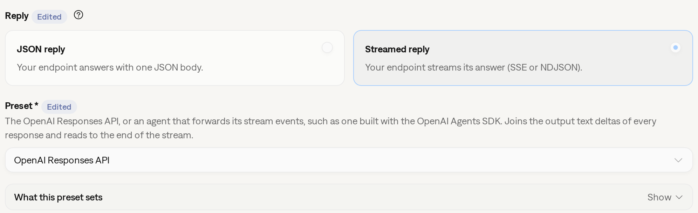
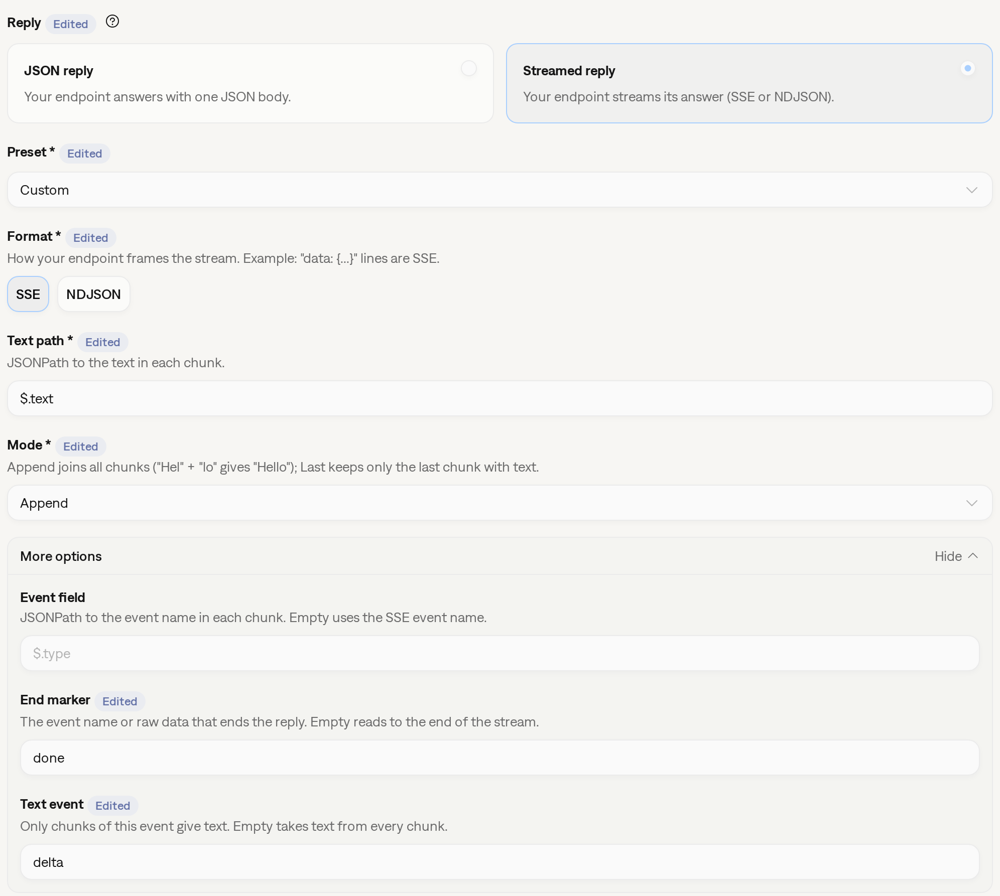

Many agents send their answer piece by piece as they write it, instead of one JSON body at the end. This guide takes such an agent from "it streams" to a tested [Endpoint Connection](/concepts/product/endpoint-connection). It starts from your stack, not from Galtea terms, and ends with a working Output Mapping for the answer, the retrieved context and the conversation id.

<Info>
  This guide uses the Dashboard. To create the same connection in code, see the [SDK streaming example](/sdk/api/endpoint-connection/create#streaming-example) or the [CLI guide](/cli/usage#connecting-a-streaming-agent). Every field is listed in [Streamed Replies](/concepts/product/endpoint-connection-configuration#streamed-replies).
</Info>

## Prerequisites

- A [Product](/concepts/product) in the [Galtea Dashboard](https://platform.galtea.ai/).
- The URL of your agent, and a way to call it with `curl`.
- The basics of an Endpoint Connection. If you have never made one, read [Direct Inferences and Evaluations from the Platform](/sdk/tutorials/direct-inferences-and-evaluations-from-platform) first.

## Does Your Agent Stream?

Call your agent once with `curl`. The `-N` flag prints each piece as it arrives, and `-i` shows the response headers:

```bash
curl -N -i https://agent.example.com/chat \
  -H "Content-Type: application/json" \
  -d '{"message": "Hello"}'
```

Look at the `Content-Type` header of the response:

| `Content-Type` | What it is | Reply in Galtea |
|----------------|------------|-----------------|
| `text/event-stream` | Server-Sent Events (SSE): lines that start with `event:` and `data:` | **Streamed reply**, format SSE |
| `application/x-ndjson` | One JSON value per line | **Streamed reply**, format NDJSON |
| `application/json` | One JSON body | **JSON reply**. You do not need this guide |

The header only helps you choose. Galtea reads the stream with the **Format** you set, whatever the header says. Some servers send NDJSON as `text/plain`: pick NDJSON when each line is one JSON value.

Most agent stacks stream when you ask them to: the OpenAI and Anthropic APIs with `"stream": true`, a Google ADK server at `/run_sse`, and a Vercel AI SDK route that returns a UI message stream. If your agent can answer both ways, a JSON reply is the simpler choice. Pick streaming when the stream is the only way your agent answers, or when you want to test the exact endpoint your users call.

## How Galtea Reads a Stream

Galtea reads the whole stream and turns it into **one object**. Your Output Mapping then reads that object with JSONPath, the same way it reads a JSON reply.

Take this invented stream. An in-house agent opens a conversation, sends its answer in two pieces, lists the passages it used, and ends:

```text Stream
event: conversation.started
data: {"conversation_id":"conv_9b21"}

event: delta
data: {"text":"You can return "}

event: delta
data: {"text":"an item within 30 days."}

event: sources
data: {"items":[{"content":"Returns are accepted within 30 days of delivery."}]}

event: done
data: {"finish_reason":"stop"}
```

With the settings of [Example 2](#example-2-custom-settings), Galtea builds this object:

```json Assembled object
{
  "text": "You can return an item within 30 days.",
  "byEvent": {
    "conversation.started": [{ "conversation_id": "conv_9b21" }],
    "delta": [{ "text": "You can return " }, { "text": "an item within 30 days." }],
    "sources": [{ "items": [{ "content": "Returns are accepted within 30 days of delivery." }] }],
    "done": [{ "finish_reason": "stop" }]
  },
  "final": { "finish_reason": "stop" }
}
```

- **`text`** is the answer: the text of the chunks that give text, joined. In **Last** mode it is the text of the last such chunk.
- **`byEvent`** keeps every chunk, grouped by its event name, in the order they came. It is a list for each event, so `[0]` is the first chunk of that event.
- **`final`** is the last chunk whose data is a JSON object or list. Agents often put the conversation id or a summary there.

## Example 1: A Preset

A preset fills every stream setting for a known agent stack. This example uses an agent built on the OpenAI Responses API, for example with the OpenAI Agents SDK, that forwards its stream events. The agent also adds one event of its own, `retrieval.results`, with the passages it found.

```text Stream
event: response.created
data: {"type":"response.created","response":{"id":"resp_7f3a","status":"in_progress"}}

event: retrieval.results
data: {"type":"retrieval.results","results":[{"content":"Orders ship within 2 business days."},{"content":"Express orders ship the same day."}]}

event: response.output_text.delta
data: {"type":"response.output_text.delta","delta":"Your order ships "}

event: response.output_text.delta
data: {"type":"response.output_text.delta","delta":"within 2 business days."}

event: response.completed
data: {"type":"response.completed","response":{"id":"resp_7f3a","status":"completed"}}
```

<Steps>
  <Step title="Choose the reply type and the preset">
    In the connection form, set **Reply type** to **Streamed reply**. In **Preset**, choose **OpenAI Responses API**. Open **What this preset sets** to see its settings: it names each event from the `type` field and takes text only from `response.output_text.delta` events.

    On a Conversation connection, the form also sets the Output Mapping to `output: $.text` when it still holds the default.
  </Step>
  <Step title="Map the answer, the retrieved context and the conversation id">
    Galtea builds this object from the stream:

    ```json Assembled object
    {
      "text": "Your order ships within 2 business days.",
      "byEvent": {
        "response.created": [{ "type": "response.created", "response": { "id": "resp_7f3a", "status": "in_progress" } }],
        "retrieval.results": [{ "type": "retrieval.results", "results": [{ "content": "Orders ship within 2 business days." }, { "content": "Express orders ship the same day." }] }],
        "response.output_text.delta": [{ "type": "response.output_text.delta", "delta": "Your order ships " }, { "type": "response.output_text.delta", "delta": "within 2 business days." }],
        "response.completed": [{ "type": "response.completed", "response": { "id": "resp_7f3a", "status": "completed" } }]
      },
      "final": { "type": "response.completed", "response": { "id": "resp_7f3a", "status": "completed" } }
    }
    ```

    Add two keys next to `output`:

    ```json Output Mapping
    {
      "output": "$.text",
      "retrieval_context": "$.byEvent['retrieval.results'][0].results[*].content",
      "session_id": "$.final.response.id"
    }
    ```

    The event name `retrieval.results` has a dot, so the path uses the bracket form. See [The Conversation Id](#the-conversation-id).
  </Step>
  <Step title="Send the id back on the next turn">
    On the first turn there is no id yet, so send it only when it exists:

    ```jinja2 Input Template
    {"message": "{{ input.user_message }}", "previous_response_id": "{{ session_id }}"}
    ```
  </Step>
</Steps>

<Frame>
  
</Frame>

<Tip>
  The `retrieval_context` key is an explicit input: Galtea stores it as a retriever span on the trace, so RAG metrics can read it. No preset maps it for you, because each agent sends its sources in its own way. See [Stream Presets](/concepts/product/endpoint-connection-configuration#stream-presets) for the Output Mapping to start from for each preset.
</Tip>

## Example 2: Custom Settings

Use **Custom** when no preset matches your agent. This example reads the in-house stream from [How Galtea Reads a Stream](#how-galtea-reads-a-stream).

<Steps>
  <Step title="Set the stream settings">
    Set **Reply type** to **Streamed reply** and **Preset** to **Custom**. Then fill in:

    | Field | Value | Why |
    |-------|-------|-----|
    | **Format** | SSE | The agent sends `event:` and `data:` lines. |
    | **Text path** | `$.text` | Each answer chunk holds its text in `text`. |
    | **Mode** | Append | Each chunk holds a new piece of the answer. Use **Last** when each chunk resends the whole answer so far. |

    Open **More options**:

    | Field | Value | Why |
    |-------|-------|-----|
    | **Event field** | *(empty)* | The agent names each event on its SSE `event:` line. Set a JSONPath such as `$.type` when the name is inside the data, which is always the case for NDJSON. |
    | **End marker** | `done` | Galtea stops reading at this event, even if the connection stays open. Leave it empty to read until the stream closes. |
    | **Text event** | `delta` | Only `delta` chunks add text. Set it when other events could hold a field at the same path. |

    When you switch to **Custom** from a preset, the form keeps that preset's settings as a start. Clear the ones your agent does not need. The form also keeps the preset's error event, and has no field for it yet.
  </Step>
  <Step title="Map the fields">
    ```json Output Mapping
    {
      "output": "$.text",
      "retrieval_context": "$.byEvent.sources[0].items[*].content",
      "session_id": "$.byEvent['conversation.started'][0].conversation_id"
    }
    ```
  </Step>
  <Step title="Send the id back on the next turn">
    ```jinja2 Input Template
    {"message": "{{ input.user_message }}", "conversation_id": "{{ session_id }}"}
    ```
  </Step>
</Steps>

<Frame>
  
</Frame>

## The Conversation Id

Most agents keep a conversation by an id: a thread id, a session id, a response id. Galtea stores the id your agent returns and sends it back on the next turn as `{{ session_id }}`. The form fills only `output: $.text`, and only on a Conversation connection, so add the `session_id` key yourself.

Find the chunk that carries the id in your stream, then pick where to read it:

- **`$.byEvent['<event>'][0].<path>`** when one event names the id, often the first one. Example 2 reads `$.byEvent['conversation.started'][0].conversation_id`.
- **`$.final.<path>`** when the last event carries it. Example 1 reads `$.final.response.id`.

Some agents send the id only on the first turn. On a later turn the path finds nothing, and Galtea keeps the id it stored. The `` branch in the Input Template covers the first turn, when Galtea has no id yet.

<Warning>
  An event name with a dot needs the bracket form. Most vendor events have one, such as `response.completed` or `thread.created`.

  - Right: `$.byEvent['conversation.started'][0].conversation_id`
  - Wrong: `$.byEvent.conversation.started[0].conversation_id` reads an event `conversation` with a field `started`. It matches nothing, and no error tells you.

  The bracket form works for every event name, so use it when you are not sure.
</Warning>

## Test the Connection

Click **Test Connection** at the bottom of the form. Galtea calls your agent with sample values, reads the stream as a real turn would, and shows two tabs:

- **Raw Response** shows the assembled object. `byEvent` starts closed: open it to see each event and to copy the paths you need.
- **Extracted Fields** shows the value of each Output Mapping key. A required key that matched nothing says "Required — no value extracted. Check your JSONPath expression."

When the stream closes before its End marker, the test shows the text that came, with the mark "The streamed reply closed before its terminal event, so this output is partial". In a run, the turn keeps that text and shows a warning mark with the same message. See [the troubleshooting row](#troubleshooting) for a cut stream.

Test Connection reads at most 1 MB of the reply. A very long sample answer can fail the test and still work in a run.

<Note>
  Test Connection sends a random `session_id`, so the `` branch of your Input Template is taken, and your agent receives an id it does not know. In a run, the first turn has no id. If your agent rejects an unknown id, test with a template that leaves the id out, then put it back.
</Note>

## Troubleshooting

| Symptom | Error text | Fix |
|---------|------------|-----|
| The turn fails after a pause | `The streamed reply sent nothing for 60 seconds (idle timeout)` | Your agent went silent after it started, for example during a long tool call. Send an SSE comment line such as `: keep-alive` while it works. 60 seconds is the default; a self-hosted deployment can change it with `ENDPOINT_STREAM_IDLE_TIMEOUT_SECONDS`. With retry on, the turn is retried. |
| The turn fails with your agent's error | `The streamed reply sent an error event "<name>": <data>` | Your agent reported a failure in its stream. Read the data and fix the agent. Galtea fails a turn on this event only when the connection names it in `streamAssembly.errorEvent` (SDK: `error_event`). The OpenAI ChatKit, OpenAI Responses API, Anthropic Messages API and Vercel AI SDK presets name `error` for you. With Custom settings, set it through the API or the SDK: the Dashboard form has no field for it. With retry on, the turn is retried. |
| The answer is cut short and marked partial | `The streamed reply closed before its terminal event, so this output is partial` | The stream closed before the End marker. Check that the End marker is the real last event of your agent, and that no proxy in front of it closes long responses. The turn keeps its text and is not retried. |
| The turn fails with no answer | `The streamed reply closed before its terminal event "<end marker>" and carried no output` | The same cut, before any text came. Check the same two things. |
| The turn fails on a long reply | `The streamed reply exceeded the stream limit of <N> bytes (ENDPOINT_STREAM_MAX_BYTES). The limit is an approximate memory limit of the assembled reply, not its raw size.` | The stream is over the [size limit](/concepts/product/endpoint-connection-configuration#streamed-replies). Stop forwarding events you do not map, such as reasoning tokens. A self-hosted deployment can raise the limit. |
| The turn fails on a bad NDJSON line | `Line <N> of the NDJSON reply is not JSON` | Line `<N>` of the reply (blank lines count) is not one JSON value. Send one JSON value per line. If your agent sends SSE, set **Format** to **SSE** instead. Galtea ignores a bad line that comes after the End marker. The turn is not retried. |
| Test Connection fails on a long reply | `Response body exceeded 1048576 bytes limit` | Test Connection reads at most 1 MB. Test with a shorter sample answer. |
| A JSON reply connection gets no output | `Failed to extract "output" from response using outputMapping: the reply looks like a stream (SSE). Set "streamFormat" and "streamAssembly" on this connection to read it.` | Your agent streams. Set **Reply type** to **Streamed reply** and follow this guide. The message says NDJSON for a line stream. |
| `output` is empty, but the stream looks right | Required — no value extracted | Open **Raw Response**. If `text` is empty, the **Text path** or the **Text event** does not match your chunks. |
| `session_id` stays empty | No value extracted | Check the path in **Raw Response**. An event name with a dot needs the [bracket form](#the-conversation-id). |

## Not Supported

Galtea reads streams over HTTP only, as SSE or NDJSON. **gRPC** and **WebSocket** agents are not supported today. If your agent speaks one of them:

- **Put a small adapter in front of it.** It takes Galtea's HTTP request, calls your agent, and answers with one JSON body or an SSE stream. Galtea then connects to the adapter like to any agent.
- **Check for a gateway you already run.** gRPC services are often exposed through gRPC-Web, Connect or a JSON transcoding gateway (for example Envoy), which already speak HTTP and JSON.
- **Run the conversation yourself.** Call your agent from your own code and send each turn to Galtea with the SDK. See [Run Dataset-Based Evaluations](/sdk/tutorials/run-dataset-based-evaluations).

## Learn More

<CardGroup cols={2}>
  <Card title="Streamed Replies reference" icon="plug" href="/concepts/product/endpoint-connection-configuration#streamed-replies">
    Every stream field, the presets and their sources, and the limits.
  </Card>
  <Card title="Direct Inferences Tutorial" icon="play" href="/sdk/tutorials/direct-inferences-and-evaluations-from-platform">
    Attach the connection to a version and run an evaluation.
  </Card>
  <Card title="SDK: create a streaming connection" icon="code" href="/sdk/api/endpoint-connection/create#streaming-example">
    The same connection in Python.
  </Card>
  <Card title="CLI: connect a streaming agent" icon="terminal" href="/cli/usage#connecting-a-streaming-agent">
    The same connection from the command line.
  </Card>
</CardGroup>
