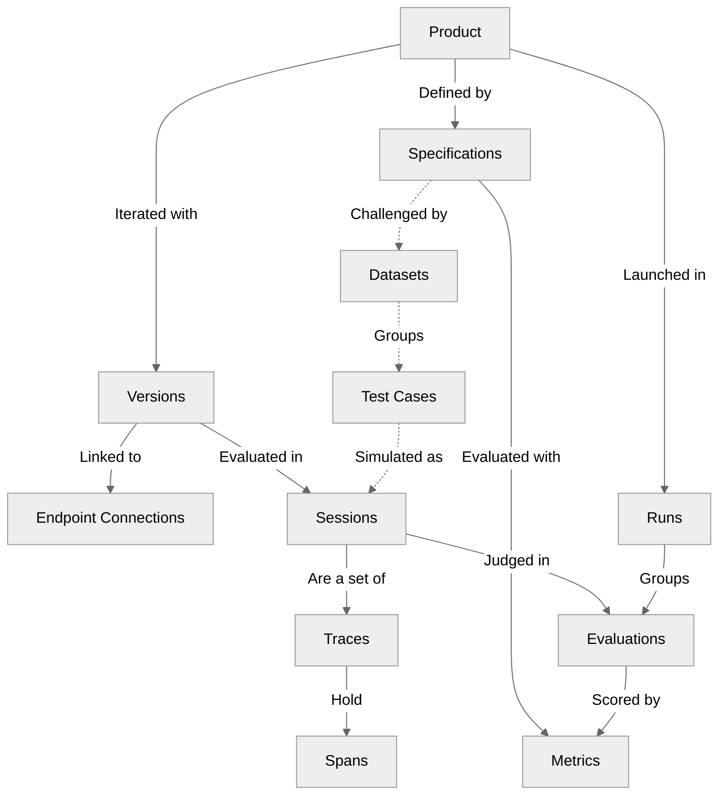

import ProductCard from '/v5.19/snippets/cards/product-card.mdx';
import SpecificationCard from '/v5.19/snippets/cards/specification-card.mdx';
import VersionCard from '/v5.19/snippets/cards/version-card.mdx';
import DatasetCard from '/v5.19/snippets/cards/dataset-card.mdx';
import TestCaseCard from '/v5.19/snippets/cards/test-case-card.mdx';
import SessionCard from '/v5.19/snippets/cards/session-card.mdx';
import TraceCard from '/v5.19/snippets/cards/trace-card.mdx';
import SpanCard from '/v5.19/snippets/cards/span-card.mdx';
import EvaluationCard from '/v5.19/snippets/cards/evaluation-card.mdx';
import MetricCard from '/v5.19/snippets/cards/metric-card.mdx';
import ModelCard from '/v5.19/snippets/cards/model-card.mdx';
import EndpointConnectionCard from '/v5.19/snippets/cards/endpoint-connection-card.mdx';
import MonitorCard from '/v5.19/snippets/cards/monitor-card.mdx';
import RunCard from '/v5.19/snippets/cards/run-card.mdx';

<Warning>
  You are reading the docs of Galtea 5.19. [Read this page in the latest version](/concepts/overview).
</Warning>

## How Everything Connects

<Info>The dotted lines represent relationships that don't exist for production-based evaluations, where there is no Dataset or Test Case and the Session is generated from real user interactions.</Info>

<Note>The diagram focuses on core concepts. Some related concepts are omitted for clarity — see the [Additional Notes](#additional-notes) section.</Note>

## At a Glance

Galtea's concepts split into four lifecycle scopes:

- **What you're testing**: Your [Product](/v5.19/concepts/product), defined by a set of [Specifications](/v5.19/concepts/product/specification) and iterated on through new [Versions](/v5.19/concepts/product/version).
- **What you test with**: [Datasets](/v5.19/concepts/product/dataset) that group [Test Cases](/v5.19/concepts/product/dataset/test-case); your Product's performance against them is measured with [Metrics](/v5.19/concepts/metric).
- **What your Product generates**: [Sessions](/v5.19/concepts/product/version/session), each a sequence of [Traces](/v5.19/concepts/product/version/session/trace) along with their [Spans](/v5.19/concepts/product/version/session/span).
- **How you measure performance**: [Evaluations](/v5.19/concepts/product/version/session/evaluation) that apply a [Metric](/v5.19/concepts/metric) to a [Session](/v5.19/concepts/product/version/session) or to a specific [Trace](/v5.19/concepts/product/version/session/trace). Each Evaluation you launch by hand belongs to a [Run](/v5.19/concepts/product/run), the record of that launch.

## Additional Notes

A few relationships are easy to misread, and some are omitted from the diagram for clarity. These notes fill in the gaps:

- **Specifications are the glue.** A [Specification](/v5.19/concepts/product/specification) links to one or more [Metrics](/v5.19/concepts/metric) so it can be evaluated, and [Datasets](/v5.19/concepts/product/dataset) can be generated from a Specification to challenge it.
- **Test Case ↔ Session.** A [Test Case](/v5.19/concepts/product/dataset/test-case) belongs to a [Dataset](/v5.19/concepts/product/dataset). When a [Session](/v5.19/concepts/product/version/session) is generated to simulate a Test Case, it references that Test Case — so the same Test Case can show up across many Sessions (for example, re-running a Dataset across multiple Versions). Sessions can also be generated without a Test Case, for example when [recording real user interactions](/v5.19/sdk/tutorials/monitor-production-responses-to-user-queries) to evaluate the Product in production.
- **Endpoint Connections shape Dataset generation.** When you create a Dataset with an [Endpoint Connection](/v5.19/concepts/product/endpoint-connection) selected, the generated Test Cases are produced to match that endpoint's expected input format.
- **Per-turn evaluations.** An [Evaluation](/v5.19/concepts/product/version/session/evaluation) can target a single [Trace](/v5.19/concepts/product/version/session/trace) instead of the whole Session — useful when you want to score, for example, how the agent's output reflected the retrieval context the RAG system provided on that turn. Per-turn Evaluations still belong to the Session that contains the turn; they additionally point at the specific Trace being scored.
- **Two types of model.** The standard [Model](/v5.19/concepts/model) is what your Product runs on — linked to a Version and used to track costs, token usage, and similar. The **evaluator model** is the model Galtea uses to score non-deterministic Metrics, an LLM judge or a [Classifier](/v5.19/concepts/metric/classifier) model; it's selected by name on the Metric, not on the Version. See [Models vs. Evaluator Models](/v5.19/concepts/model#models-vs-evaluator-models) on the Model page for the full distinction.
- **[User Groups](/v5.19/concepts/user-group) for human evaluation.** A User Group routes [Human Evaluation](/v5.19/concepts/metric/evaluation-types#human-evaluation) Metrics to a specific set of annotators, so only the right reviewers see those Evaluations on the dashboard.
- **[Runs](/v5.19/concepts/product/run) group the Evaluations of one launch.** Galtea creates a Run every time you launch Evaluations, and returns its id. The Run records who launched what, against which [Version](/v5.19/concepts/product/version), and how it ended. An Evaluation carries a Run or a [Monitor](/v5.19/concepts/product/monitor), never both: a Run is what a Monitor is, on the development side. A Run's Sessions are a union: the [Sessions](/v5.19/concepts/product/version/session) it created, plus the distinct Sessions of its Evaluations. So a launch that generates inferences and evaluates no Metric still gets a Run, and a launch over Sessions that already exist reaches them through its Evaluations.
- **[Monitors](/v5.19/concepts/product/monitor) watch production automatically.** A Monitor is an always-on rule on a [Product](/v5.19/concepts/product) (optionally one [Version](/v5.19/concepts/product/version)) that scores a sampled fraction of its production [Sessions](/v5.19/concepts/product/version/session) with metric families, Specifications, or both, with no run to trigger by hand.

## All Concepts

<CardGroup cols={3}>
  <ProductCard />
  <SpecificationCard />
  <VersionCard />
  <EndpointConnectionCard />
  <MonitorCard />
  <DatasetCard />
  <TestCaseCard />
  <SessionCard />
  <TraceCard />
  <SpanCard />
  <RunCard />
  <EvaluationCard />
  <MetricCard />
  <ModelCard />
</CardGroup>
